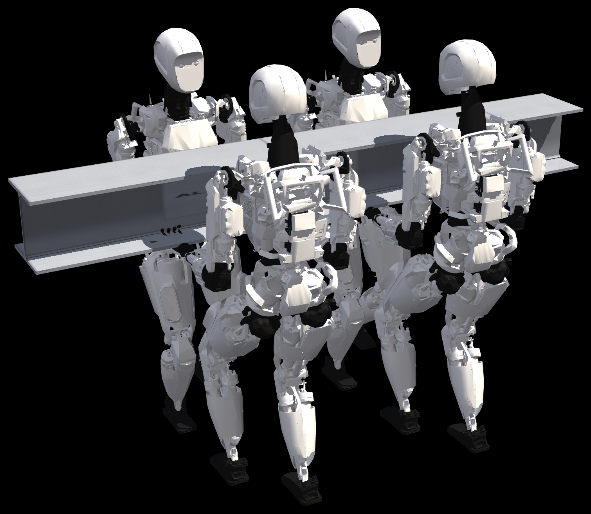

# External and Internal Impedance for Robot Teams Sharing a Load

Research code and compact simulation results for **External and Internal Impedance for Robot Teams Sharing a Load: Exact Decoupling and Decay Certificates**, by Mehdi Heydari Shahna.

Four Apollo humanoid models lift, carry and place a 2.4 m aluminium girder with an HEA 280 cross-section. The main girder mass is 63.0665 kg. The controller separates object motion from the internal forces that distribute the load across the robots. Exact decoupling and decay certificates apply under the manuscript's exact-model, fixed-mode assumptions. The MuJoCo experiments evaluate the controller with soft frictional contacts, actuator limits, model errors and sensor noise.



## Code, results and video

The main result has tag `al_n4_kz0`. All 41 supplied compact result files and 37 mission summaries are preserved. The 183.36 kg runs and heavier mass sweeps are capacity comparisons retained from this version of the study; they are not the main aluminium mission.

The supplementary MP4 is provided as a GitHub Release asset, together with compact results and a source archive. Its two caption clarifications distinguish exact-model certificates from the observed contact simulation. The source video generator uses the same wording. Video frames and multi-GB mission logs are excluded from Git.

| Path | Purpose |
|---|---|
| `teamimp/` | controller, compiled team dynamics, sharing QP, mission, scene and simulation |
| `experiments/` | original numerical experiments, analyses and figure generators |
| `results/` | original compact results and source/result SHA-256 manifest |
| `video/make_video.py` | render and assemble the supplementary video from mission logs |
| `paper/figures/fig_teaser.png` | teaser extracted from the accompanying manuscript |
| `tools/check_release.py` | check preserved numerical files and reference values |
| `tools/check_environment.py` | test dependencies, model, dynamics API and a short control step |
| `tools/reproduce.py` | portable, sequential reproduction commands |
| `docs/RESULTS.md` | result index and numerical reference values |
| `docs/REPRODUCING.md` | full reproduction workflow and expected inputs |
| `docs/VALIDATION.md` | validation scope and limitations |

## Miniforge setup

From Miniforge Prompt, change to this repository and run:

```bat
conda env create -f environment.yml
conda activate team-impedance
python tools/check_release.py
python tools/check_environment.py --render
```

If the environment already exists, use `conda env update -n team-impedance -f environment.yml` in place of creation. The environment uses Python 3.11 and MuJoCo 3.16.0. Rendering defaults to GLFW on Windows and EGL elsewhere; an existing `MUJOCO_GL` setting is respected. FFmpeg with `libx264` is required for video encoding. `git` and the GitHub CLI are installed for the accompanying publishing helper.

## Reproduce

```bat
python tools/reproduce.py figures
python tools/reproduce.py main
python tools/reproduce.py exact
python tools/reproduce.py capacity
python tools/reproduce.py video
python tools/reproduce.py full --dry-run
```

`figures` regenerates the exact-model and contact plots from supplied compact time series. `main` runs the main aluminium mission and checks its completion. `video` regenerates the three missions read by the video renderer and then renders the MP4; the supplied release video can be used without doing this. `full` runs the current study's 72 sequential commands, including all 37 missions, contact and exact-model checks, analyses, figures and video. Remove `--dry-run` to execute that plan. Full reproduction may take many hours and requires several GB for raw logs and frames.

Generated data go to an isolated sibling `.reproduction_work` directory. They do not replace the supplied compact results. Append `--work-dir PATH` to choose another location or `--force` to rerun completed jobs. The original Linux shell commands remain in `experiments/run_all.sh` and its component scripts. The original README is preserved in `docs/ORIGINAL_REPRODUCTION.md`.

Raw mission arrays, full logs, the trajectory file and the saved post-lift state were not included in the code archive. Mission/trajectory plots, rendered snapshots and a newly rendered video require those regenerated inputs. A completed benchmark run and a deliberately failed comparison are different study outcomes; an execution error stops the portable runner.

## Citation and attribution

Citation metadata are in `CITATION.cff`. The supplied Apollo model is from MuJoCo Menagerie; its Apache License 2.0 and asset attribution are retained. No project-wide license for the original research code was specified in the supplied materials. See `LICENSE.md` and `THIRD_PARTY_NOTICES.md`.
